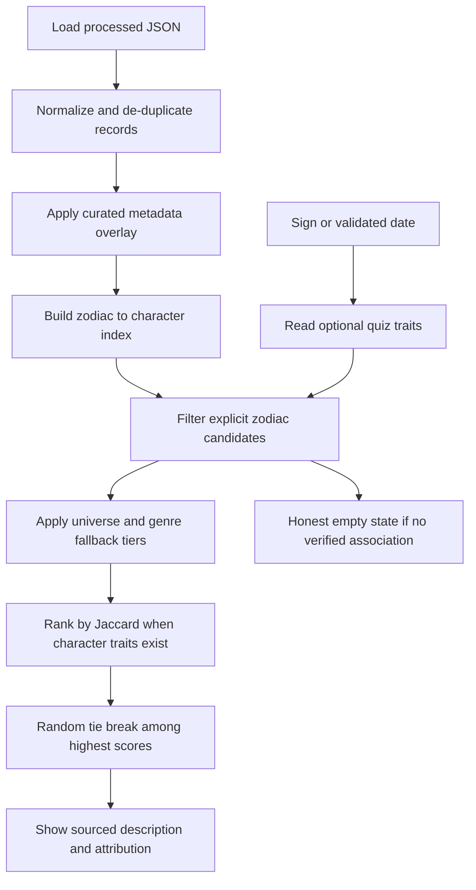

# Cosmic Casting frontend

The React, Vite, and TypeScript app is isolated in `frontend/`. It reads the existing validated dataset in `../data/processed/characters.json`; it does not modify the Scrapy pipeline or the original scraped data. Before dev/build, `scripts/sync-data.mjs` copies that file into the Vite public directory. Local image filesystem paths are never exposed to browser code.

## What the inspected dataset contains

The processed JSON is an object with a `characters` array (103 records at last collection), mirrored in CSV. Available fields include character name, universe/franchise, aliases, description, remote image URL, zodiac sign, personality traits, source URL, attribution, and image license. Names, universe/franchise, and source attribution are populated; all zodiac signs, licensed image URLs, image paths, genre tags, and personality traits are currently missing. Character descriptions are also often missing. Source images were not available under the licensing check, so the interface uses an original initials-based fallback illustration. Records have distinct IDs; data normalization drops malformed rows and duplicate IDs.

The frontend displays available universe values from the data. Genre filters are visibly unavailable rather than populated with invented values. Zodiac matching requires explicit associations; until those are curated, the matcher explains that it cannot verify a match and directs people to the character library. Add future verified associations by character ID to `src/data/curatedCharacterMetadata.json`; this overlay keeps the Scrapy output unchanged. Supported overlay fields are `zodiacSigns`, `genres`, `traits`, `paragraphs`, `active`, `imageUrl`, `sourceUrl`, and `attribution`. Leave it empty until the values have been verified and image reuse rights are clear.

Quiz answers are optional, mapped to a normalized user-trait vocabulary, and are not a scientific assessment. They do not produce a score when character traits are missing. The optional name is used only in a greeting. A selected photo is type/size checked and previewed with a temporary browser object URL; it is not uploaded, stored, or used to infer traits. No backend or database is needed for this static dataset.

## Run locally

Install Node.js 20 or later, then from PowerShell:

```powershell
cd D:\zodiac\char\frontend
npm install
npm run dev
```

Run unit tests with `npm test`. Create a production build with `npm run build`, then preview it with `npm run preview`. Each command synchronizes the latest existing processed JSON before Vite runs or builds. Deploy the generated `dist/` directory to any static host.

The interface includes the cinematic landing page, manual/date zodiac input with date validation, data-derived universe selection, optional personality prompts, honest empty-match handling, and a searchable, paginated character explorer. Western sign boundaries use the conventional tropical zodiac dates. Character matching uses only explicit zodiac links; if links exist later, it applies zodiac + universe + genre, zodiac + universe, zodiac + genre, and zodiac-only tiers. Trait overlap uses Jaccard similarity only when both user and character trait sets exist, with random selection among exact top ties. Current records have no zodiac, genre, or trait metadata, so no match or personality score is fabricated.

## Matching flow and complexity



Normalization/index creation is `O(N + A)`, where `N` is record count and `A` is the total number of explicit zodiac associations. Index lookup is expected `O(1)`; filtering/ranking is `O(K)` for the selected sign’s `K` candidates. Explorer search is `O(N)` per debounced query, and pagination limits rendered cards to 24.

## Deployment

Build with `npm run build` and deploy `dist/` to a static host. The build copies the current processed dataset into the public bundle. Rebuild after updating or re-exporting the Scrapy dataset. No API keys, server, database, name, DOB, or photo upload are required. Current matching remains in the honest empty state until verified associations are added to the separate metadata map.
